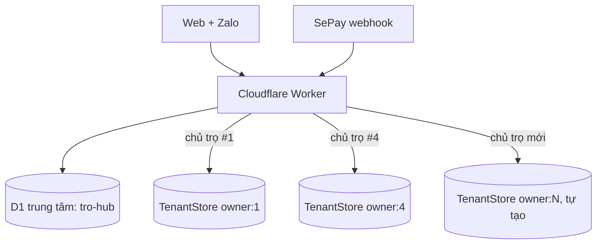
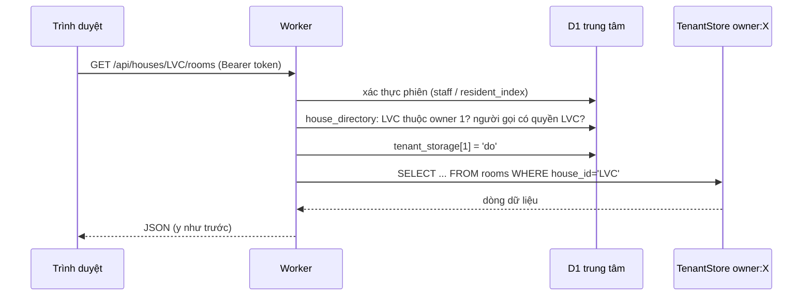
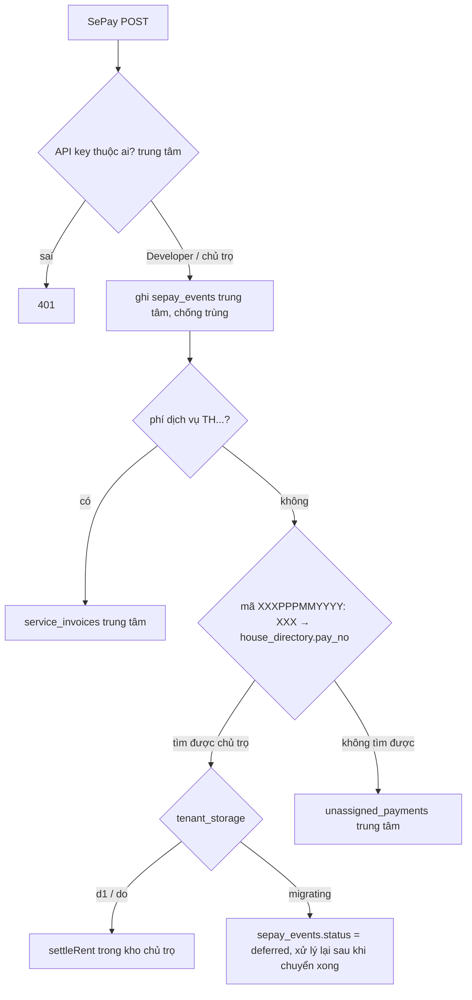
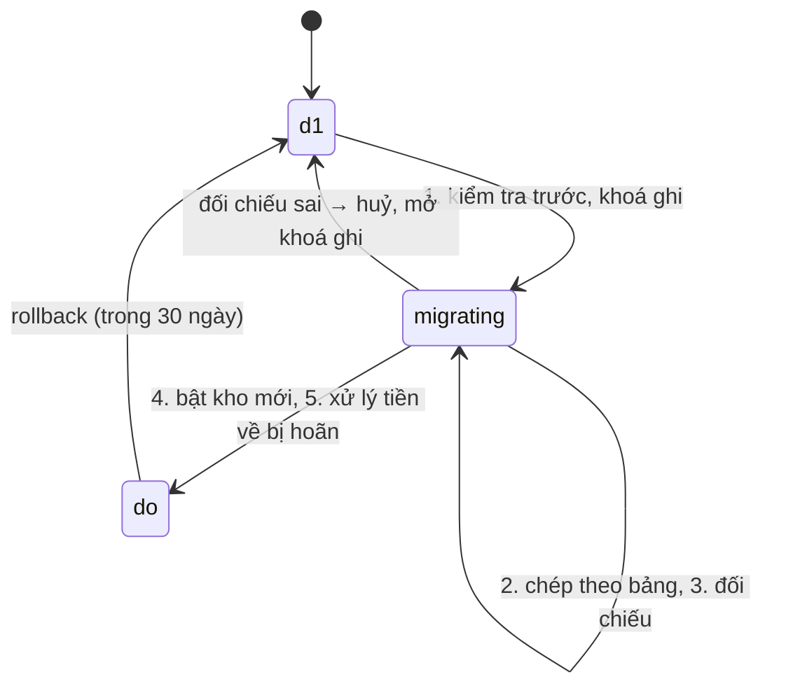

# Thiết kế: mỗi chủ trọ một kho dữ liệu riêng (Durable Objects SQLite)

Ngày: 19/11/2026 · Trạng thái: **đã duyệt 19/11/2026** (khoá ghi dưới 1 phút; R2 hoãn) · Nhánh: `cloudflare-multi-house-ubwehz`

## 1. Mục đích và lý do

Trọ Hub chuẩn bị thương mại hoá: mỗi chủ trọ là một khách hàng trả tiền riêng. Hiện mọi chủ trọ dùng chung một D1 (`tro-hub`), cách ly chỉ dựa vào code lọc theo `house_id`. Mục tiêu:

- **Cách ly vật lý** dữ liệu từng chủ trọ: một lỗi truy vấn cũng không thể đọc sang chủ trọ khác.
- **Xuất, xoá, sao lưu, khôi phục riêng từng chủ trọ** (khách ngừng dịch vụ, đòi dữ liệu, lỡ tay xoá).
- **Mở rộng**: mỗi chủ trọ có sức chứa riêng (10 GB/kho trên gói Paid), chủ trọ lớn không làm chậm người khác.
- Thêm chủ trọ mới **không cần deploy lại** (kho tự tạo khi dùng lần đầu).

### Mục tiêu
1. Bảng của chủ trọ chuyển sang một Durable Object SQLite riêng cho mỗi chủ trọ.
2. Giao diện, đường dẫn API, Express, SePay webhook URL **không đổi**.
3. Chuyển dữ liệu thật **từng chủ trọ một**, có chạy thử, đối chiếu, và quay lại được.
4. Bộ test cách ly chạy trên cả hai kiểu lưu trữ và cho kết quả giống nhau.
5. **Bắt buộc:** khi SePay báo tiền về đủ cho một hoá đơn, **cả cư dân (trang thanh toán) lẫn chủ trọ/quản lý (trang admin) đều thấy "Đã đóng"**, ở mọi trạng thái `d1` / `migrating` / `do`, kể cả trong lúc khoá ghi.

### Làm sau, khi kho chủ trọ đã chạy ổn
- Đẩy trạng thái thanh toán xuống app ngay khi SePay báo tiền về (WebSocket từ kho chủ trọ), thay cho việc app hỏi lại mỗi 5 giây.
- App hiện dữ liệu lần trước ngay khi mở, cập nhật ngầm khi dữ liệu mới về.

### Không làm trong dự án này
- Tự lập hoá đơn, nhập điện nước trên D1, chuyển giặt sấy / kỳ kê khai khỏi Express (dự án sau).
- Đổi giao diện.
- Tách kho theo từng căn (đã quyết: theo chủ trọ).

### Coi là thất bại dù code chạy được
- Mất hoặc lệch bất kỳ dòng dữ liệu nào khi chuyển.
- Dừng hệ thống quá vài phút cho một chủ trọ.
- Dữ liệu chủ trọ A đọc được từ phiên của chủ trọ B.
- Một bước chuyển không quay lại được.
- Một khoản tiền SePay về trong lúc chuyển bị mất.

## 2. Ràng buộc đã xác minh (tài liệu Cloudflare, 19/11/2026)

| Mục | Giá trị |
|---|---|
| SQLite Durable Objects | Có trên gói Free và Paid |
| Dung lượng mỗi kho | 10 GB (Paid) · 1 GB (Free); tổng tài khoản 5 GB trên Free |
| Ghi / đọc trên Free | 100.000 dòng ghi/ngày · 5 triệu dòng đọc/ngày |
| Tham số mỗi câu SQL | tối đa 100 (giống D1) · câu SQL tối đa 100 KB |
| Khôi phục theo thời điểm (PITR) | bất kỳ lúc nào trong 30 ngày, theo từng kho; không chạy ở local |
| Xem/sửa dữ liệu | Data Studio trên dashboard Cloudflare |
| Khai báo lớp | `exports` (mới, thay `migrations`): `[exports.TenantStore] type="durable-object" storage="sqlite"` |
| Test | `@cloudflare/vitest-plugin` chạy được Durable Objects (`runInDurableObject`) |

Quy mô hiện tại (dữ liệu thật): 3 căn, 63 phòng, 69 cư dân, 352 hoá đơn, 352 chỉ số điện nước, 13 khoản tiền chưa gắn căn — rất nhỏ so với mọi giới hạn trên.

## 3. Các cách đã cân nhắc

| Cách | Tóm tắt | Kết luận |
|---|---|---|
| A. Một D1 chung + lớp lọc theo chủ trọ | Nhanh, ít rủi ro, nhưng không cách ly vật lý | Không chọn (bạn chọn B để thương mại hoá) |
| **B. DB trung tâm + mỗi chủ trọ một Durable Object SQLite** | Cách ly vật lý, tự tạo kho, có PITR | **Đã chọn** |
| C. Mỗi chủ trọ một database D1 | Worker không gắn D1 mới lúc chạy; phải deploy hoặc gọi API HTTP | Loại |
| Tách theo căn (F1) | Chia nhỏ đúng chỗ cần gộp (báo cáo, quản lý nhiều căn) | Loại |

Trong cách B, có hai kiểu viết code truy cập kho:
- **B1. Adapter giống D1 (chọn):** kho chủ trọ nhận câu SQL qua RPC, Worker dùng một đối tượng có cùng giao diện `prepare/bind/first/all/run/batch` như D1. Phần lớn code chỉ đổi `c.env.DB` thành `tenant`. Port nhanh, diff dễ review, cùng một câu SQL chạy được trên D1 cũ lẫn kho mới (cần cho giai đoạn chuyển tiếp và test so sánh).
- B2. Mỗi thao tác một phương thức RPC riêng (`getRooms`, `settleRent`…): gọn hơn về lâu dài nhưng phải viết lại toàn bộ truy vấn. Có thể làm dần sau khi B1 ổn định.

## 4. Kiến trúc



- **D1 trung tâm** (database `tro-hub` hiện có): tài khoản, chủ trọ, danh bạ căn, định tuyến, thu phí dịch vụ, SePay, nhật ký.
- **TenantStore**: một lớp Durable Object; mỗi chủ trọ một thực thể, tên `owner:<staff.id>`, chứa toàn bộ bảng nghiệp vụ của chủ trọ đó.
- Worker là nơi duy nhất quyết định chủ trọ nào, dựa trên **phiên đăng nhập + danh bạ trung tâm**, không bao giờ dựa trên tham số người dùng gửi lên.

### 4.1. Chia bảng

| Nhóm | Bảng | Ghi chú |
|---|---|---|
| **Trung tâm** | `staff`, `staff_houses` | Tài khoản Developer, chủ trọ, quản lý; quản lý được giao căn nào |
| | `house_directory` (**mới**) | `house_id, owner_id, name, status, delete_after, pay_no, modules, room_count, resident_count` — danh bạ để định tuyến, cấp mã căn, trang Developer |
| | `resident_index` (**mới**) | `resident_id PK AUTOINCREMENT, phone UNIQUE, owner_id, house_id` — biết cư dân thuộc kho nào khi đăng nhập; cấp id cư dân duy nhất toàn hệ thống |
| | `tenant_storage` (**mới**) | `owner_id, backend ('d1'\|'migrating'\|'do'), changed_at, migrated_at, note` — công tắc chuyển từng chủ trọ |
| | `service_modules`, `service_invoices`, `service_payments`, `settings` | Thu phí dịch vụ, cấu hình |
| | `sepay_connections`, `sepay_manual_webhooks`, `sepay_events` | SePay; `sepay_events` thêm cột `status` (`done`/`deferred`) |
| | `integrations`, `sheet_archive`, `sheet_archive_chunks` | Google, bản lưu Sheet cũ |
| | `audit_log` | Nhật ký thao tác (đã có `house_id`; thêm `owner_id`) |
| | `unassigned_payments` (**mới**) | Khoản tiền về không xác định được chủ trọ |
| **Kho chủ trọ** | `houses` | Bản đầy đủ (địa chỉ, ngân hàng…) của các căn thuộc chủ trọ |
| | `rooms`, `residents`, `invoices`, `payments`, `meter_readings`, `house_rates`, `payment_gates`, `notifications` | Giữ nguyên cột như D1 hiện tại để cùng một câu SQL chạy được ở cả hai nơi |
| | `meta` | `schema_version`, `owner_id`, `last_write_at`, `migrated_from` |

Dữ liệu cá nhân của cư dân (CCCD mã hoá, địa chỉ, ngày sinh, liên hệ khẩn cấp, mật khẩu) **chỉ nằm trong kho chủ trọ**. Trung tâm chỉ giữ số điện thoại và id để định tuyến đăng nhập.

`houses` có ở cả hai nơi theo vai trò khác nhau: kho chủ trọ giữ bản đầy đủ, `house_directory` giữ vài trường định tuyến. Mọi thao tác sửa căn đi qua một hàm duy nhất ghi cả hai (mục 6.3).

### 4.2. Định tuyến một request



`tenantFor(c, houseId)`:
1. Lấy `owner_id` của căn từ `house_directory` (404 nếu không có).
2. Kiểm tra người gọi có quyền căn đó (giữ nguyên logic `requireHouse` / `canAccessHouse`).
3. Đọc `tenant_storage[owner_id]`:
   - `d1` → adapter trỏ vào D1 dùng chung (bảng cũ), như hôm nay;
   - `do` → adapter gọi `TENANT.get(TENANT.idFromName('owner:' + owner_id), { locationHint: 'apac' })` — chỉ định đặt kho ở châu Á – Thái Bình Dương, vì kho nằm cố định gần nơi nó được tạo lần đầu (script chuyển dữ liệu có thể chạy từ máy ở nước ngoài);
   - `migrating` → đọc từ D1, **ghi bị từ chối** với 503 "Đang nâng cấp dữ liệu, thử lại sau ít phút".

### 4.3. Đăng nhập và phiên

- **Staff**: không đổi (bảng `staff` trung tâm).
- **Cư dân**: `resident_index` theo số điện thoại → `owner_id` → kho chủ trọ kiểm tra mật khẩu, trạng thái, trả `viewer`.
- Token mới có thêm `tid` (owner id) cho cư dân, để mỗi request đi thẳng tới đúng kho. Token cũ chưa có `tid` vẫn dùng được: tra `resident_index` theo `sub`.
- `password_changed_at` của cư dân nằm trong kho chủ trọ; kiểm tra phiên cư dân là một lần gọi kho (cùng lúc với lấy tên, phòng).

### 4.4. SePay webhook



- **Xác nhận "Đã đóng" không bị chặn bởi khoá ghi:** khi chủ trọ đang `migrating`, các API trạng thái thanh toán (`/api/payment/status`, `/api/admin/billing`, `/api/admin/dashboard`, `/api/houses/:id/invoices`) đọc hoá đơn từ D1 **cộng thêm** các `sepay_events` `deferred` của phòng/tháng đó ở trung tâm; đủ tiền thì trả trạng thái `paid` ngay. Mở khoá xong, bước 5 ghi chính thức vào hoá đơn trong kho.
- Không có khoản tiền nào bị mất trong lúc chuyển: sự kiện luôn được ghi ở trung tâm trước, phần cộng tiền vào hoá đơn được làm lại ngay khi chủ trọ chuyển xong.

### 4.5. Trang Developer và báo cáo toàn hệ thống

- Danh sách chủ trọ / căn đọc `house_directory` (có `room_count`, `resident_count` lưu sẵn) — không phải gọi từng kho.
- Bộ đếm được cập nhật ngay sau mỗi thao tác thêm/xoá phòng, duyệt/xoá cư dân, và được **tính lại hằng đêm** từ từng kho (tự sửa nếu lệch).
- Tạo hoá đơn phí dịch vụ: hỏi trực tiếp từng kho số phòng tại thời điểm tạo (chính xác tuyệt đối cho phần tiền).

### 4.6. Lịch chạy (cron)

| Lịch | Việc | Sau khi đổi |
|---|---|---|
| `*/10 * * * *` | Chép số tiền từ Sheet cũ (chỉ căn Trung Kim, LVC) | Worker tải CSV, gửi các dòng sang kho của chủ trọ #1 |
| `0 19 * * *` | Xoá căn hết hạn chờ xoá | Xoá trong kho chủ trọ + `house_directory` |
| mới, hằng đêm | Tính lại bộ đếm, đối soát danh bạ | — |

## 5. Code: cấu trúc mới

```
cloudflare/src/
  tenant/schema.ts     DDL bảng kho chủ trọ + danh sách migration theo phiên bản (meta.schema_version)
  tenant/store.ts      class TenantStore extends DurableObject: exec/batch qua RPC, import/export, checksum, stats
  tenant/db.ts         tenantDb(): adapter giống D1 (prepare/bind/first/all/run/batch, meta.changes, RETURNING)
                       cho cả hai backend 'd1' và 'do'
  tenant/route.ts      tenantFor(c, houseId), tenantOfOwner(env, ownerId), kiểm tra quyền, chế độ 'migrating'
  central/directory.ts house_directory, resident_index, cấp mã căn, bộ đếm
  migrate/tenant.ts    chuyển dữ liệu một chủ trọ (mục 7)
  routes/*.ts          index.ts (2.100 dòng) tách theo khu vực trong lúc port: auth, houses, residents,
                       invoices, payments, notifications, admin, dev, billing, sepay
```

- Kho chủ trọ tự tạo bảng và chạy migration trong `blockConcurrencyWhile` khi khởi động, theo `meta.schema_version` (giống cách D1 dùng `d1_migrations`).
- `wrangler.toml` thêm: `[[durable_objects.bindings]] name="TENANT" class_name="TenantStore"`, `[exports.TenantStore] type="durable-object" storage="sqlite"`. (R2 hoãn: không thêm binding.)
- D1 trung tâm có migration `0019_central_directory.sql`: tạo `house_directory`, `resident_index`, `tenant_storage`, `unassigned_payments`, thêm cột vào `sepay_events`, `audit_log`; điền dữ liệu từ bảng hiện có; mọi chủ trọ khởi đầu ở `d1` (không đổi hành vi).

## 6. Quy tắc nhất quán giữa trung tâm và kho

Không có giao dịch xuyên hai nơi, nên mọi thao tác chạm cả hai theo đúng thứ tự sau:

1. **Tạo cư dân:** ghi `resident_index` trước (lấy id, giữ số điện thoại) → ghi kho với id đó → nếu kho lỗi thì xoá dòng `resident_index`.
2. **Đổi số điện thoại / xoá cư dân:** kho trước → `resident_index` sau; lỗi bước sau thì ghi `audit_log` cảnh báo và để đối soát hằng đêm sửa.
3. **Tạo / sửa / xoá căn:** `house_directory` trước (cấp `pay_no`) → kho → cập nhật lại bộ đếm.
4. **Đối soát hằng đêm:** so `resident_index`, `house_directory` với từng kho; tự sửa lệch về bộ đếm; báo lệch về danh bạ trên trang Developer (không tự xoá).

## 7. Script chuyển dữ liệu

Chạy **trong Worker** (vì kho chỉ truy cập được qua Worker), gọi bằng API chỉ Developer dùng được, kèm script dòng lệnh `cloudflare/scripts/migrate-tenant.mts` để bấm chạy và in báo cáo.

```
POST /api/dev/storage/:ownerId/dry-run     chép sang kho thử 'dryrun:owner:<id>', đối chiếu, không đổi gì
POST /api/dev/storage/:ownerId/migrate     chuyển thật (các bước dưới)
POST /api/dev/storage/:ownerId/rollback    quay về D1
GET  /api/dev/storage                      trạng thái từng chủ trọ
```

### 7.1. Các bước chuyển một chủ trọ



1. **Kiểm tra trước:** đếm dòng từng bảng của chủ trọ trong D1; kho đích phải trống (hoặc `reset=true` chỉ khi kho chưa từng bật); ghi `tenant_storage = 'migrating'` → mọi thao tác ghi của chủ trọ này trả 503, đọc vẫn chạy.
2. **Chép** theo thứ tự `houses → house_rates → rooms → residents → invoices → meter_readings → payments → payment_gates → notifications`, mỗi lần 200 dòng, **giữ nguyên id**. `payments` gồm cả khoản chưa gắn căn mà số tài khoản nhận khớp tài khoản ngân hàng của căn thuộc chủ trọ này (13 khoản hiện tại đều về tài khoản đuôi 1800). Sau khi chép, đặt bộ đếm AUTOINCREMENT của kho bằng id lớn nhất.
3. **Đối chiếu:** với mỗi bảng, số dòng bằng nhau **và** mã băm SHA-256 của toàn bộ dòng (xếp theo id, chuẩn hoá JSON) bằng nhau giữa D1 và kho; thêm tổng tiền hoá đơn theo tháng và số hoá đơn đã đóng theo tháng. Sai một chỗ → dừng, xoá kho đích, trả `tenant_storage` về `d1`.
4. **Bật:** `tenant_storage = 'do'`, ghi `migrated_at`. Từ giờ đọc ghi đi vào kho.
5. **Xử lý tiền về bị hoãn:** chạy lại các `sepay_events.status='deferred'` của chủ trọ này qua `settleRent` trong kho.
6. **Kiểm tra sau:** gọi các API đọc chính (danh sách căn, phòng, hoá đơn tháng này, cổng thanh toán) bằng phiên của chủ trọ và so với kết quả chụp ở bước 1.

**Khoá tự hết hạn:** `tenant_storage` có thêm `lock_expires_at` = lúc khoá + 10 phút. Hết hạn mà chưa bật xong thì mọi request coi như `d1` và trạng thái tự trả về `d1`; kho đích được xoá trước lần chuyển sau. Trang Developer có nút "Mở khoá" làm việc tương tự ngay lập tức.

**Lịch chép từ Sheet** bỏ qua chủ trọ đang `migrating`; ngay sau bước 4, Worker chép lại một lần cho chủ trọ đó vào kho mới.

Thời gian khoá ghi ước tính dưới **1 phút** cho chủ trọ #1 (khoảng 900 dòng). Dữ liệu trong D1 **không bị xoá**: giữ nguyên, chỉ không dùng nữa, ít nhất 30 ngày.

### 7.2. Quay lại (rollback)

- Nếu kho chưa có ghi nào sau khi bật (`meta.last_write_at` ≤ `migrated_at`): chỉ cần đổi `tenant_storage` về `d1`.
- Nếu đã có ghi mới: khoá ghi → chép ngược từ kho về D1 (xoá các dòng của chủ trọ đó trong D1 rồi chèn lại từ kho, cùng cách đối chiếu) → `d1`.
- Lỗi dữ liệu trong kho (không phải lỗi chuyển): dùng PITR khôi phục kho về thời điểm trước sự cố.

### 7.3. Chạy thử trên dữ liệu thật trước

- Bản sao lưu D1 thật đã có (xuất ngày 18/11, trước migration 0016). Dựng lại ở local + chạy toàn bộ migration + chạy `migrate` cho cả hai chủ trọ ở local, so sánh API trước/sau.
- Trên bản thật: chạy `dry-run` cho từng chủ trọ (chỉ chép sang kho thử, không khoá ghi, không đổi công tắc) để chắc đối chiếu khớp với dữ liệu thật trước khi chuyển.

## 8. Kiểm thử

| Loại | Nội dung |
|---|---|
| Cách ly (đã có, mở rộng) | Chạy **toàn bộ** bộ test API hai lần: một lần mọi chủ trọ ở `d1`, một lần ở `do`. Kết quả phải giống hệt. |
| Kho chủ trọ | Tạo bảng, migration theo phiên bản, adapter: `first/all/run/batch`, `RETURNING`, `meta.changes`, lỗi ràng buộc trả đúng lỗi |
| Chuyển dữ liệu | Dữ liệu mẫu → `migrate` → đối chiếu khớp; cố tình làm lệch một dòng → phải dừng và quay về `d1`; chạy lại lần hai không sinh trùng |
| Webhook trong lúc chuyển | Tiền về khi `migrating` → ghi `deferred` → **ngay lúc đó** API của cư dân và của chủ trọ đều trả `paid` → sau khi bật được cộng đúng một lần, trạng thái vẫn `paid` |
| Xác nhận hai phía | Ở cả ba trạng thái `d1`/`migrating`/`do`: tiền về đủ → `/api/payment/status` (cư dân) và `/api/admin/billing`, `/api/admin/dashboard`, `/api/houses/:id/invoices` (chủ trọ, quản lý) đều thấy "Đã đóng"; tiền về thiếu → cả hai thấy còn thiếu bao nhiêu |
| Rollback | Bật `do`, ghi thêm, rollback → D1 có đủ dữ liệu mới |
| So sánh đầu ra | Ảnh chụp JSON của các API đọc chính trước và sau khi chuyển phải giống nhau |

Mỗi giai đoạn chỉ được gộp khi `npm test` xanh và kiểm tra kiểu xanh.

## 9. Review và đưa lên

1. Review code ở mức **high** cho từng giai đoạn; riêng adapter, định tuyến và script chuyển dữ liệu review ở mức cao nhất được phép.
2. Deploy bản mới với **mọi chủ trọ vẫn ở `d1`** — hệ thống chạy y như hôm nay, kho mới chưa dùng. Theo dõi 1 ngày.
3. Sao lưu D1 (`wrangler d1 export`) ngay trước khi chuyển.
4. `dry-run` cả hai chủ trọ trên bản thật — đối chiếu phải khớp.
5. **Chủ trọ #4 (NTTD) trước:** 19 phòng, chưa có cư dân — rủi ro thấp nhất. Theo dõi 24–48 giờ.
6. **Chủ trọ #1** vào giờ ít người dùng (đêm), có mặt bạn hoặc mình để kiểm tra ngay.
7. Sau 30 ngày ổn định: migration riêng xoá bảng chủ trọ khỏi D1 trung tâm (cần bạn duyệt riêng).

Quay lại được ở mọi bước đến hết ngày thứ 30.

## 10. Lộ trình theo giai đoạn

| GĐ | Việc | Kết quả kiểm chứng | Ước tính |
|---|---|---|---|
| 1 | Bảng trung tâm mới (`0019`), `tenant_storage` mặc định `d1`, `TenantStore` + schema + adapter, binding/`exports` | Test adapter; deploy không đổi hành vi | 3–4 ngày |
| 2 | `tenantFor` + port các API theo khu vực, tách `index.ts` thành `routes/*` | Bộ test chạy xanh ở cả `d1` và `do` | 5–7 ngày |
| 3 | Đăng nhập cư dân qua `resident_index`, token `tid`; webhook định tuyến + `deferred`; cron; bộ đếm Developer | Test webhook trong lúc chuyển; test đăng nhập | 2–3 ngày |
| 4 | Script chuyển dữ liệu: dry-run, migrate, rollback, đối chiếu băm; API + CLI | Test chuyển/lỗi/rollback; chạy với bản sao lưu thật ở local | 3 ngày |
| 5 | Nút xuất dữ liệu một chủ trọ (JSON) trên trang Developer, đối soát hằng đêm, trang trạng thái + mức sử dụng gói Free | Test xuất/đối soát | 1–2 ngày |
| 6 | Review, deploy (`d1`), dry-run thật, chuyển #4, chuyển #1 | Đối chiếu khớp; API trước/sau giống nhau | 2–3 ngày (+ thời gian theo dõi) |
| | **Tổng** | | **khoảng 3–4 tuần** |

Sau khi bạn duyệt tài liệu này, mình lập **kế hoạch chi tiết từng việc** (file, test, lệnh kiểm tra cho mỗi bước) rồi mới bắt đầu GĐ 1.

## 11. Rủi ro và cách xử lý

| Rủi ro | Cách xử lý |
|---|---|
| Wrangler / `@cloudflare/vitest-plugin` chưa hỗ trợ đầy đủ khai báo `exports` ở local | Kiểm tra ngay đầu GĐ 1; nếu vướng, dùng `[[migrations]] new_sqlite_classes` (vẫn được hỗ trợ) và chuyển sang `exports` sau |
| Mỗi request thêm một bước gọi sang kho chủ trọ | Kho thường chạy gần nơi được tạo, độ trễ vài ms; gộp nhiều câu SQL của một API vào một lần `batch` |
| Kho "ngủ" rồi khởi động lại chậm ở request đầu | Chấp nhận được ở quy mô hiện tại; theo dõi thời gian phản hồi sau khi chuyển #4 |
| Lệch dữ liệu giữa trung tâm và kho | Thứ tự ghi cố định (mục 6) + đối soát hằng đêm |
| Gói Free chạm giới hạn dòng ghi/ngày khi nhiều chủ trọ | Theo dõi trên dashboard; lên gói Paid trước khi mở bán rộng |
| Script chuyển lỗi giữa chừng, chủ trọ kẹt ở trạng thái khoá | Khoá tự hết hạn sau 10 phút, tự quay về `d1`; nút "Mở khoá" trên trang Developer |
| Lịch chép từ Sheet ghi vào D1 trong lúc đang chuyển | Lịch chép bỏ qua chủ trọ `migrating`, chép lại một lần ngay sau khi bật |
| Gói Free chạm giới hạn mà không ai biết | Trang Developer hiện mức sử dụng (dung lượng từng kho, tổng, dòng ghi/ngày), cảnh báo ở 70–80% |
| Kho bị đặt xa người dùng Việt Nam (tạo lần đầu từ máy ở nước ngoài) | Luôn tạo kho với `locationHint: 'apac'`; đo thời gian phản hồi sau khi chuyển #4 |
| PITR không chạy ở local | Chỉ thử PITR trên kho thử ở bản thật, không phụ thuộc vào nó cho việc chuyển dữ liệu |

## 12. Những gì mình tự quyết (bạn xem lại)

- Adapter giống D1 (B1) để port nhanh và chạy so sánh hai backend; viết lại thành phương thức RPC riêng (B2) là việc sau.
- Thông tin đăng nhập staff ở trung tâm; dữ liệu cá nhân và mật khẩu cư dân ở kho chủ trọ, trung tâm chỉ giữ số điện thoại để định tuyến.
- Id cư dân cấp ở trung tâm để duy nhất toàn hệ thống; id phòng, hoá đơn, tiền là riêng trong từng kho.
- Bộ đếm phòng/cư dân lưu sẵn ở trung tâm cho trang Developer, tính lại hằng đêm; riêng tiền phí dịch vụ luôn hỏi trực tiếp kho.
- Tách `index.ts` thành nhiều file theo khu vực trong lúc port.
- Giữ dữ liệu D1 cũ 30 ngày sau khi chuyển rồi mới xoá (xoá cần duyệt riêng).

## 13. Cần bạn trả lời

1. ~~Gói Free hay Paid~~ — **đã chốt: Free**, lên Paid khi gần chạm giới hạn (có cảnh báo trên trang Developer).
2. ~~Khoá ghi~~ — **đã duyệt:** dưới 1 phút, làm ban đêm, một lần cho mỗi chủ trọ.
3. ~~R2~~ — **hoãn:** chưa bật. Sao lưu dựa vào PITR 30 ngày của từng kho + nút xuất dữ liệu bằng tay; bật R2 sau nếu cần.
