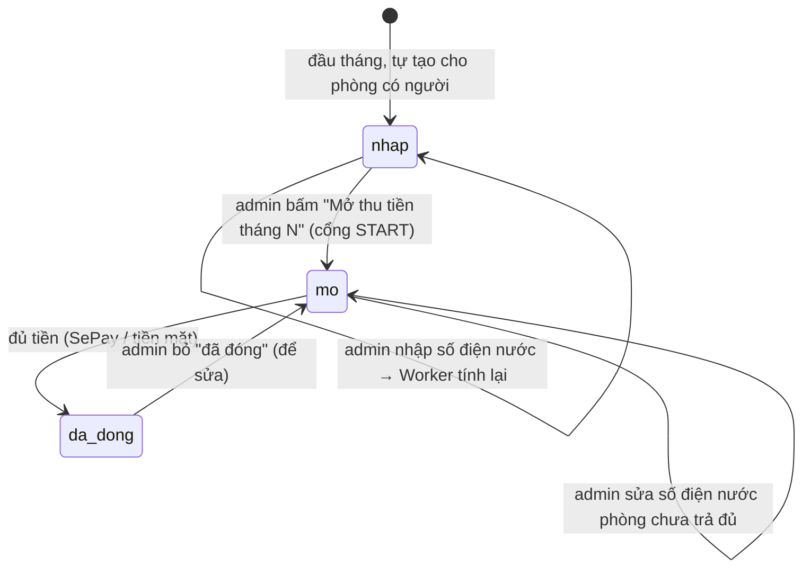

# Thiết kế: Worker là nguồn dữ liệu chính, Google Sheet chỉ để xuất ra

Ngày: 19/11/2026 · Trạng thái: **đã duyệt 19/11/2026** · Nhánh: tạo mới từ `main`

## 1. Mục đích và lý do

Trọ Hub chuẩn bị bán cho các chủ trọ khác. Chủ trọ mới không có Google Sheet nào, nên mọi thứ họ cần (đăng nhập, cư dân, điện nước, hoá đơn, thu tiền) phải chạy hoàn toàn trên Cloudflare Worker.

Hôm nay hệ thống còn chạy ngược ở 4 chỗ:

| Việc | Hiện tại | Sau dự án này |
|---|---|---|
| Nhập điện nước | Admin → Express `/api/admin/room-detail` → Apps Script ghi vào Sheet → 10 phút sau Worker đọc ngược về D1 | Admin → Worker → lưu ngay |
| Tính tổng hoá đơn | Công thức trong ô Sheet | Worker tính |
| App cư dân xem hoá đơn | Express `/api/sheets/tenant-data` đọc Sheet | Worker |
| Đăng nhập Zalo, đăng ký, duyệt cư dân | Express `/api/auth/zalo`, `/api/auth/register`, `/api/admin/accounts` đọc/ghi Sheet | Worker |
| Google Sheet | Nguồn dữ liệu | Chỉ nhận bản sao một chiều từ Worker, để xuất/xem |

Lợi ích phụ: tắt việc đọc Sheet mỗi 10 phút làm số dòng ghi D1 mỗi ngày giảm mạnh (hôm nay đã 37,5 nghìn/100 nghìn của gói Free).

### Mục tiêu
1. Cư dân mới (chỉ có trong Worker) đăng nhập được bằng Zalo và bằng số điện thoại + mật khẩu, thấy hoá đơn và trả tiền được.
2. Chủ trọ nhập điện nước, Worker tự tính và lưu hoá đơn; trang cư dân và trang chủ trọ thấy cùng một con số.
3. Chủ trọ tự cấu hình phí: điện, nước luôn có; các dịch vụ khác do chủ trọ thêm, đặt tên, đặt giá.
4. Sheet chỉ nhận dữ liệu từ Worker; Worker không đọc Sheet nữa.
5. Nhà của bạn (Trung Kim, LVC) tính ra **đúng từng đồng** như công thức Sheet hiện nay.

### Không làm trong dự án này
- Giặt sấy, hợp đồng CT01, kỳ kê khai (vẫn chạy như cũ qua Express/Sheet; sẽ lệch dần khi Sheet không còn là nguồn, cần dự án sau).
- Dịch vụ tính theo công thức tuỳ biến (xem mục 11, "Bàn sau").
- Đổi giao diện ngoài những màn hình nêu ở đây.

### Coi là thất bại dù code chạy được
- Một phòng của bạn bị tính khác công thức Sheet hiện nay.
- Cư dân thấy hoặc trả được hoá đơn chưa có số điện nước (chuyện tháng 11).
- Số tiền một hoá đơn đổi sau khi cư dân đã trả đủ.
- Cư dân hiện có không đăng nhập được sau khi bật luồng mới.
- Không quay về luồng cũ được nếu luồng mới có vấn đề.

## 2. Cách tính tiền (đã chốt với bạn)

Lấy từ công thức các tab tháng `032026`–`112026` của Sheet (kiểm tra: tổng = công thức trên 44/44 phòng ở 3 tháng).

| Khoản | Công thức | Ghi chú |
|---|---|---|
| Số điện | `max(số mới − số cũ, 0)` | |
| Tiền điện | `số điện × đơn giá điện` | đơn giá chỉnh được theo nhà |
| Số nước | `max(số mới − số cũ, 0)` | |
| Tiền nước | `số nước × đơn giá nước` | đơn giá chỉnh được theo nhà |
| Tiền phòng | `rooms.price` (mục "Phòng & Khách") | đã khớp 45/45 phòng tháng 11 |
| Dịch vụ tuỳ chọn | `giá × số lượng` theo "tính theo" (mục 3) | rác, internet, xe, bảo vệ… |
| Khác | `số điện × (3.300 − đơn giá điện)` | **chỉ nhà của bạn**, thiết lập ẩn |
| Tiền cọc | nhập tay | **không cộng vào tổng** |
| **Tổng** | phòng + điện + nước + dịch vụ + khác | |

Mọi số tiền là số nguyên đồng (không làm tròn vì mọi phép nhân đều ra số nguyên).

## 3. Cấu hình phí (mục "Cài đặt phí")

- **Điện, nước:** luôn có, chỉ chỉnh đơn giá.
- **Dịch vụ tuỳ chọn:** danh sách chủ trọ tự thêm, mỗi dịch vụ có:
  - tên (ví dụ "Rác", "Internet", "Xe máy", "Bảo vệ"),
  - giá,
  - **tính theo** một trong 3 cách:

| Tính theo | Số lượng |
|---|---|
| Mỗi phòng | 1 |
| Mỗi người | số cư dân đã duyệt đang ở phòng, có thể đặt **tối đa** (Internet nhà bạn: tối đa 2, giống Sheet chỉ đếm Họ tên 1 và 2) |
| Mỗi xe | số cư dân của phòng có biển số xe |

- Có thể bật/tắt từng dịch vụ cho **từng phòng** (phòng không dùng internet = 0, như Sheet đang có phòng 0đ internet).
- Dữ liệu ban đầu cho nhà của bạn: Rác 30.000/phòng; Internet 40.000/người (tối đa 2); Xe máy 50.000/xe (đang tính 50.000; ô M5 tháng 11 ghi 60.000 nhưng không được dùng, **bạn xác nhận lại khi đọc**).
- Thay đổi giá chỉ áp dụng cho hoá đơn **chưa phát hành**; hoá đơn đã mở thu giữ nguyên số tiền trừ khi admin bấm tính lại (mục 4).

## 4. Vòng đời hoá đơn mỗi tháng (đã chốt với bạn)

1. **Đầu tháng (cron):** tạo hoá đơn **nháp** cho mọi phòng có cư dân đã duyệt; số cũ = số mới tháng trước; tiền phòng và dịch vụ điền sẵn. Cư dân **không thấy** nháp.
2. **Admin nhập số mới** từng phòng; Worker tính lại ngay; admin thấy tổng từng phòng.
3. **Mở thu tiền:** chính là cổng START/STOP hiện có, chuyển sang Worker. Còn phòng chưa nhập số điện nước → cảnh báo, admin xác nhận mới mở.
4. **Sau khi mở:** sửa được phòng chưa trả đủ; phòng đã đóng khoá sửa.
5. SePay, cộng tiền hoãn, xác nhận hai phía: giữ nguyên như đã làm (không đổi).

Hoá đơn thêm một trạng thái hiển thị: `draft` (nháp) bên cạnh `unpaid | pending | paid | cash`. API cư dân không bao giờ trả hoá đơn `draft`; SePay gặp mã của hoá đơn `draft` thì ghi tiền vào `payments` (không mất) nhưng không đổi trạng thái.

## 5. Đăng nhập, đăng ký, duyệt cư dân

- **Zalo:** app gửi mã Zalo lên Worker; Worker hỏi Zalo lấy số điện thoại đã xác minh (giống Express đang làm), tra `resident_index` (rồi `staff`) theo số đó, cấp token như đăng nhập thường. Không còn tra Sheet.
- **Số điện thoại + mật khẩu:** đã chạy trên Worker; bỏ đường dự phòng đọc Sheet ở frontend.
- **Đăng ký cư dân mới:** ghi vào Worker với trạng thái `pending` (giữ đúng thứ tự ghi danh bạ trước, kho sau).
- **Danh sách chờ duyệt / duyệt / từ chối / xoá:** chuyển các API `/api/admin/accounts*` sang Worker.
- **Hồ sơ cư dân** (`/api/profile/update`): sang Worker.

## 6. App cư dân và trang chủ trọ đọc từ Worker

- Thay `/api/sheets/tenant-data` bằng một API Worker trả hồ sơ + hoá đơn (các tháng đã mở) của cư dân đang đăng nhập.
- Trang chủ trọ: `/api/admin/rooms`, `/api/admin/room-detail` (xem/sửa), `/api/admin/config`, `/api/admin/months` chuyển sang Worker.
- Sửa luôn chỗ gán cứng tháng `10/2026` ở frontend (đã có trên nhánh `fix-payment-current-month`).

## 7. Sheet một chiều

- Worker **không đọc** Sheet nữa: tắt `syncLegacySheets` (cron 10 phút) và `ensureMonthFresh` trong các API.
- Mỗi khi hoá đơn hoặc số điện nước của nhà có Sheet thay đổi, Worker đưa vào hàng đợi; một lần chạy (cron 10 phút) ghi các dòng đổi ra tab tháng qua Apps Script, **giữ đúng bố cục cột hiện nay** (A–P, hàng 7–50) để bạn quen mắt. Ghi đè giá trị, không ghi công thức.
- Chủ trọ không có Sheet thì không xuất gì.
- Sau khi bật luồng mới ổn định, bạn nên đổi Sheet về chế độ riêng tư (hiện "ai có link cũng xem được" và có dữ liệu cá nhân).

## 8. Bật luồng mới an toàn

- Một công tắc `settings.source_of_truth` = `sheet` (mặc định, như hôm nay) | `worker`.
- Deploy code với công tắc ở `sheet`: không đổi gì cho người dùng.
- **Trước khi bật:** chạy kiểm chứng (mục 9) trên dữ liệu thật — tính lại 8 tháng bằng công thức mới và so với Sheet.
- **Bật:** đặt `worker`; frontend đọc công tắc qua một API nhỏ và dùng API Worker; cron ngừng đọc Sheet.
- **Quay lại:** đặt lại `sheet`. Trong lúc ở `worker`, điện nước nhập trong Worker vẫn được xuất ra Sheet (mục 7), nên quay về không mất số liệu.

## 9. Kiểm thử

| Loại | Nội dung |
|---|---|
| Công thức | Bảng ví dụ từ 3 tháng thật (điện 3.300/3.500 kèm "Khác", internet 0/40k/80k, xe 0–150k) → tổng đúng từng đồng |
| Kiểm chứng dữ liệu thật | Lệnh chỉ đọc: với 352 hoá đơn đã có, tính lại từ số điện nước + giá + dịch vụ và so `invoices.total`; liệt kê mọi phòng/tháng lệch |
| Vòng đời | nháp ẩn với cư dân; mở thu cảnh báo khi thiếu số; khoá sửa phòng đã đóng; SePay vào hoá đơn nháp không đổi trạng thái |
| Đăng nhập | Zalo (giả lập trả số điện thoại) cho cư dân chỉ có trong Worker; đăng ký → chờ duyệt → duyệt → đăng nhập |
| Hai backend | mọi test chạy trên d1 và do như dự án trước |
| Công tắc | `sheet` giữ nguyên hành vi cũ; `worker` không gọi Sheet nào khi đọc |

## 10. Lộ trình

| GĐ | Việc |
|---|---|
| 1 | Bảng phí mới (dịch vụ tuỳ chọn, tính theo, bật/tắt theo phòng) + hàm tính tiền + kiểm chứng 8 tháng |
| 2 | Vòng đời hoá đơn (nháp, mở thu, khoá sửa) + admin nhập điện nước qua Worker |
| 3 | Zalo, đăng ký, duyệt cư dân, hồ sơ sang Worker |
| 4 | App cư dân và trang chủ trọ đọc Worker + công tắc |
| 5 | Xuất Sheet một chiều, tắt đọc Sheet, deploy với công tắc `sheet` |

Bật công tắc `worker` trên bản thật: chỉ khi bạn đồng ý.

## 11. Bàn sau (ghi chú theo yêu cầu của bạn)
- Dịch vụ tính theo công thức tuỳ biến (ví dụ bậc thang điện, phí theo m²).
- Giặt sấy, hợp đồng CT01, kỳ kê khai lấy dữ liệu từ Worker.
- Chuyển nhà của bạn sang kho riêng (đã có công cụ, làm sau khi luồng này ổn định).

## 12. Chi tiết chốt sau khi rà soát (để người xây không phải đoán)

**Lưu trữ hoá đơn**
- Không đổi ràng buộc `status` của bảng `invoices` (tránh dựng lại bảng ở D1 và mọi kho). Thêm cột `issued_at` (NULL = **nháp**). API cư dân chỉ trả hoá đơn có `issued_at`.
- Thêm bảng `invoice_lines` (invoice_id, tên, số lượng, đơn giá, thành tiền, mã dịch vụ) cho dịch vụ tuỳ chọn. Các cột cũ `trash/internet/parking` giữ cho lịch sử; hoá đơn mới vẫn điền chúng khi dịch vụ được gắn "cột Sheet" K/L/M (để xuất Sheet), tổng luôn = tổng các dòng.
- 352 hoá đơn cũ **đóng băng**, không tính lại; kiểm chứng (mục 9) chỉ đọc và báo lệch.
- Dịch vụ có thêm thuộc tính tuỳ chọn "cột Sheet" (K/L/M) chỉ dùng cho nhà có Sheet.

**"Khác" của nhà bạn**: thiết lập ẩn theo nhà `giá điện thực thu` = 3.300; Khác = số điện × (giá thực thu − đơn giá điện). Nhà không đặt giá thực thu thì không có dòng Khác. Xuất Sheet ghi giá trị đã tính vào cột N.

**Thời điểm bật (cutover)**
- Hoá đơn tháng đang chạy đã có trong D1 (từ Sheet) được coi là **đã mở** (`issued_at` = lúc bật) nếu cổng tháng đó đang START, ngược lại là nháp; số điện nước tháng đó đã có trong D1 thì giữ.
- Công tắc `source_of_truth` là **một công tắc chung** (chỉ nhà bạn có Sheet).

**Quay lại (`sheet`)**: là lối thoát khẩn cấp, chỉ đảm bảo **hoá đơn và điện nước** (đã xuất ra Sheet). Cư dân đăng ký mới trong lúc ở `worker` chỉ có trong Worker: khi quay lại họ không đăng nhập qua Express được. Trang Developer cảnh báo số cư dân như vậy trước khi quay lại. Hàng đợi xuất Sheet phải chạy hết trước khi chuyển về `sheet` (nút quay lại chờ hàng đợi rỗng).

**Xuất Sheet**: hàng đợi trong D1, cron 10 phút, mỗi lần thử tối đa 5 lần rồi báo lỗi trên trang Developer. Phòng không có dòng trong tab tháng (`sheet_row` trống, ví dụ phòng mới) thì bỏ qua và liệt kê. Ghi giá trị cột A–P và tô màu đã đóng/chưa đóng như hiện nay; không ghi công thức.

**Phân quyền**: các API admin chuyển sang Worker dùng đúng cơ chế token staff và `tenantFor` hiện có (chủ trọ/quản lý chỉ thấy căn của mình); không còn dựa vào `requireAdmin` của Express.

**Zalo**: số điện thoại là duy nhất toàn hệ thống (cư dân và staff), nên không có trường hợp trùng. Cư dân `pending` → báo "đang chờ chủ trọ duyệt"; không tìm thấy → giữ thông báo hiện nay. Worker cần secret `ZALO_APP_SECRET` (hiện chỉ có trên Render).

**Cư dân vào ở giữa tháng**: khi được duyệt vào phòng chưa có hoá đơn tháng đó, tạo hoá đơn nháp cho phòng.

**Sửa hoá đơn đã trả một phần (bạn đã duyệt)**: sửa được hoá đơn chưa trả đủ; sau khi sửa, trạng thái tính lại theo tiền đã nhận + tiền chờ so với tổng mới (đủ thì tự "Đã đóng"); tổng mới thấp hơn tiền đã nhận thì hiển thị "dư X đồng" cho chủ trọ tự xử lý, không tự hoàn tiền. Phòng đã đóng khoá sửa; bỏ "đã đóng" rồi mới sửa được, sau đó cũng tính lại như trên.

**Giặt sấy (bạn đã chốt)**: không thuộc dự án này; cư dân đăng ký mới sau khi bật luồng mới chưa dùng được giặt sấy cho tới dự án sau.

**Khoá Zalo (bạn đã chốt)**: bạn tự thêm secret `ZALO_APP_SECRET` vào Worker trên Cloudflare trước khi bật luồng mới; không cản code và deploy với công tắc đang tắt.

## 13. Những gì mình tự quyết (bạn xem lại)
- Xe máy giữ **50.000/xe** cho nhà của bạn (theo số tiền đang tính, không theo ô M5 = 60.000).
- Internet "mỗi người" có giới hạn tối đa, nhà bạn đặt 2.
- Số người = cư dân đã duyệt của phòng; số xe = cư dân có biển số.
- Xuất Sheet theo hàng đợi mỗi 10 phút, giữ bố cục cột cũ, chỉ ghi giá trị.
- Có công tắc `sheet | worker`, mặc định `sheet`.
- Hoá đơn nháp đầu tháng do cron tạo.
